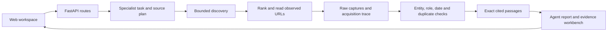

# Architecture

Aegis is a modular monolith: FastAPI routes invoke specialist workflows over one
shared acquisition and evidence platform. The frontend uses ordinary HTML/CSS/JS;
a separate service per specialist is unnecessary for the current workload.

## Code map

| Responsibility | Location |
| --- | --- |
| Application and routes | `backend/main.py`, `backend/api/` |
| Specialist entrypoints | `backend/agents/` |
| Research orchestration stages | `backend/application/research/` |
| Planning, qualification and passage selection | `backend/services/research/` |
| Shared acquisition routing and adapters | `backend/infrastructure/acquisition/` |
| Native operations and compatibility interfaces | `backend/services/agent_reach/` |
| Settings and provider integration | `backend/core/`, `backend/infrastructure/llm/` |
| Persistence and report contracts | `backend/database.py`, `backend/models/` |
| Browser rendering | `frontend/unified-report-renderer.js`, `frontend/forensic-explorer.js` |

## Important decisions

**One acquisition platform, different research tasks.** Financial disclosures,
incident reports, trending coverage and attributed statements need different
selection rules, but share HTTP transport, budgets and provenance. Duplicating
scraping stacks would make access policy and timeout behavior diverge.

**Discovery is not evidence.** Feed entries, search snippets and publisher indexes
are leads. Article bodies need their own acquisition and qualification records.
A successful request is not automatically a useful source.

**Raw captures and selected passages are separate.** Captures retain acquisition
metadata. Published passages carry source identity and offsets. Reference material
and older background must not silently become current incident evidence.

**Bounded work.** A research request has deadlines, read limits and HTTP admissions.
Redirects and fallback readers must preserve access and network restrictions.
Blocking operations use worker boundaries rather than blocking asynchronous handlers.

**Explicit uncertainty.** Missing dates, unavailable sources, insufficient support
and unassessed identity remain different states. Source grouping is a heuristic,
not proof of independence. Current UI assessment inconsistencies are known limitations.

**Optional model assistance.** Models can propose queries and aid analysis; their
outputs need validation and never substitute for retrieved source bytes. Offline
fixtures measure deterministic behavior separately from live provider quality.

**Compatibility before deletion.** Several historical import paths re-export the
canonical implementation. They remain because tests and callers depend on their
interfaces; file count alone is not evidence that a module is dead code.

See [API contracts](api/README.md), [security boundaries](SECURITY.md) and
[evaluation limits](EVALUATION.md).
